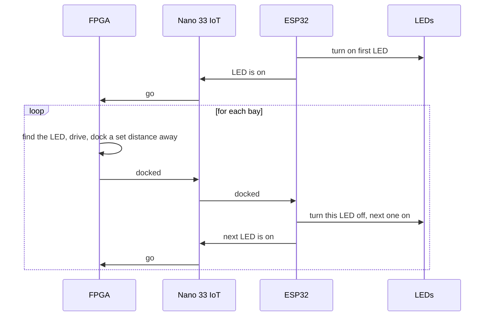

# Bay handoff: who tells who what

The robot docks at one bay, then the next LED lights up and the robot goes to that one. Four things take part:

- **FPGA**: sees the LED, drives, docks.
- **Nano 33 IoT**: on the robot. Passes messages between the FPGA and the ESP32.
- **ESP32**: at the bays. Switches the LEDs.
- **LEDs**: red, green, blue, one lit at a time.

The FPGA handles all of the robot's functionality. The Arduino just tells the ESP32 that the robot is docked and to change the lights, and the ESP32 tells the Arduino that the lights have been changed and the robot should now find its new dock.
