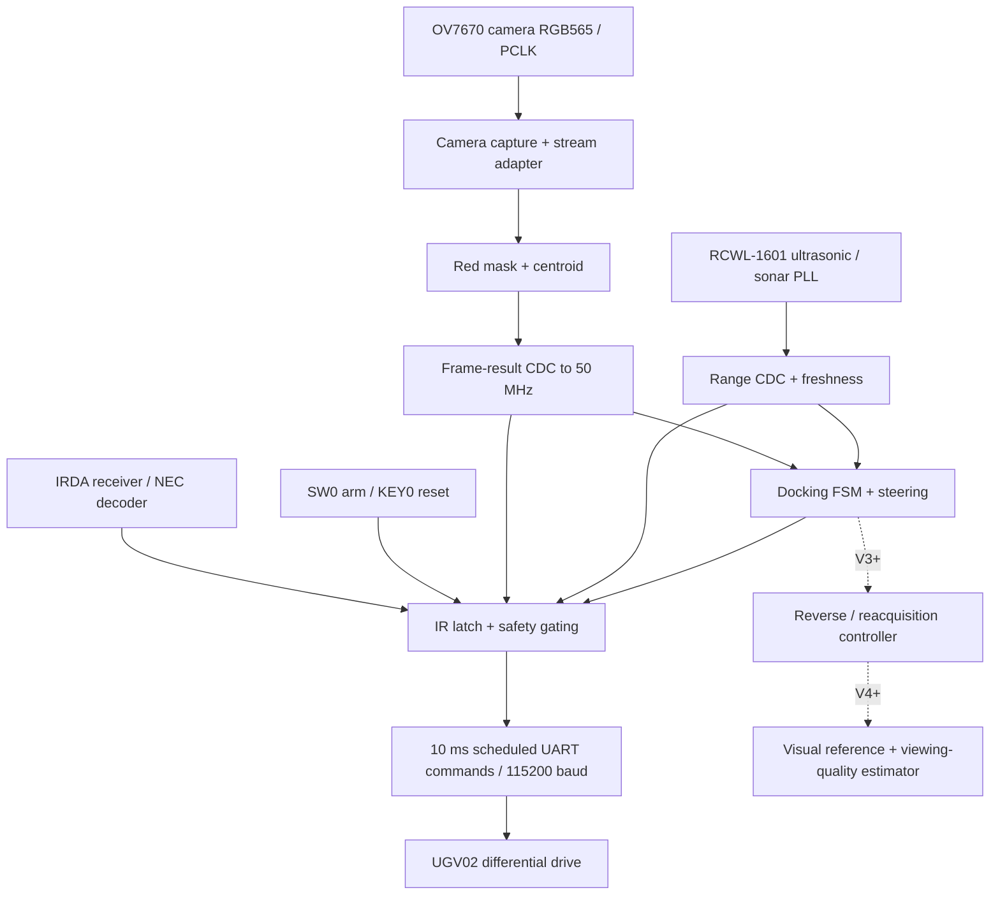

# MTRX3700 Major Project — FPGA Autonomous Precision Docking

**Group 26 | University of Sydney | Semester 2, 2026**  
**README revision:** `0.3.1` — 27 October 2026  
**RTL baseline:** V2 integrated on `main` at merge commit [`bd8a90e`](https://github.com/jyan6400/MTRX3700-Major-Project/commit/bd8a90e); V1 hardware checkpoint [`20cbc4b`](https://github.com/jyan6400/MTRX3700-Major-Project/commit/20cbc4b) is retained for comparison. A V2 release tag is deferred pending physical validation.  
**Current priority:** Complete V2 physical camera/sonar/docking validation while beginning V3 repeated multi-bay RTL; retain the V2 baseline for regression and V4 comparisons.  
**Target milestone:** V4 HD-candidate demonstration; V5 is optional and must not jeopardise V4.

> **Living specification.** This README describes the current implemented baseline and *proposed* V2–V5 work. Subsequent rungs, interfaces, assignments and test targets may change as hardware feasibility and verification results become known. Review and increment the README revision after **every version's testing/verification stage**; record decisions in the revision log at the bottom. A proposed feature is not evidence that it is implemented, synthesised or physically demonstrated.

## 1. Project overview and engineering narrative

Our project is an **airport-inspired autonomous precision-docking system**, demonstrated at model scale using a DE1-SoC-controlled UGV02 differential-drive robot. The robot detects an illuminated docking marker using an OV7670 camera, estimates its horizontal alignment from FPGA-processed pixels, steers toward the designated bay and uses forward-facing ultrasonic ranging to halt at a controlled stand-off distance.

The airport context provides a practical engineering narrative: visual docking guidance, alignment with a designated bay, approach speed control, repeatability, operational supervision and fail-safe stopping. **This is a scale-model demonstration, not a full aircraft docking, localization or collision-avoidance system.** We deliberately avoid requiring 3D pose estimation, SLAM or unvalidated visual odometry on the critical path.

The project develops cumulatively:

- **V1 — Single-bay docking:** acquire one red marker, align, approach and stop (hardware bring-up verified; quantitative physical docking still pending).
- **V2 — Robust docking:** suppress visual/range noise, improve detection reliability and smooth motion.
- **V3 — Repeated multi-bay docking:** dock, make a bounded retreat, reacquire the next illuminated bay and repeat.
- **V4 — Visibility-aware repositioning (HD candidate):** improve the return-to-viewing-position behaviour using actual visual feedback, and compare against V3's timed baseline.
- **V5 — Optional extension:** detect a target switching/disappearing during operation and safely stop, replan and reacquire.

The three illuminated bays form an airport-inspired **dynamic bay-assignment demonstration**, not a separate unrelated game. Optional target selection/LED switching hardware may be used only as an approved peripheral; the FPGA must retain camera processing, navigation decisions and motor safety.

### Preliminary performance goals (not yet achieved)

| Metric | Preliminary goal | Earlier threshold | Measurement required |
|---|---:|---:|---|
| Docking position error | ≤30 mm | ≤75 mm | Physical trials with a defined reference position |
| Camera-to-UART processing latency | ≤75 ms | ≤150 ms | Real sensor event to relevant complete UART command |
| Docking repeatability | ≤40 mm | ≤100 mm | Repeated physical trials under controlled start conditions |

Targets may be refined with tutor approval and documented experimental evidence. Do not confuse the **8.826 ms simulated stop-event-to-UART-message observation** with full camera-to-actuation latency or physical stopping distance.

## 2. Actual V1 implementation status (25 October)

**Known-good source checkpoint:** [`20cbc4b`](https://github.com/jyan6400/MTRX3700-Major-Project/commit/20cbc4b), merged to `main` on 25 October 2026. It includes integrated Quartus project settings, DE1-SoC pin assignments, preliminary timing constraints, revised centroid RTL/tests and temporary camera-debug LED mappings. The hardware observations below were made with that diagnostic `.sof`. Tag `v1.0` **only after** committing this updated README; record the final tag hash in the verification log.

| Area | V1 implementation | Evidence and status |
|---|---|---|
| FPGA implementation | DE1-SoC `5CSEMA5F31C6`; integrated QPF/QSF/SDC | **PASS:** Quartus Prime Lite 18.1 full compilation, 0 errors; 279 warnings to triage; fully constrained setup/hold; worst setup **+4.719 ns**, hold **+0.122 ns** across reported corners |
| Camera capture | OV7670 configuration, RGB565 acquisition, stream/CDC | **Physical preliminary PASS:** `LEDR0` configuration complete, `LEDR1` frame heartbeat blinking; LEDR0 does not independently prove camera register ACKs |
| Red vision and perception | Red mask, frame centroid and horizontal target coordinate | **Physical preliminary PASS:** target-valid and left/right LEDs responded to illuminated red LED; position accuracy and unequal apparent field of view not quantified |
| Ultrasonic | RCWL-1601 echo ranging, CDC, validity/freshness | **Physical preliminary PASS:** valid-range indicator observed and responded to a nearby hand; absolute distance accuracy and the 250 mm stopping threshold not physically characterised |
| IR and arming | SW0 arming and latched NEC IR stop | **Physical PASS:** CH+ releases IR latch; POWER activates latch and stopped moving wheels; SW0 OFF independently stopped both wheels in elevated-chassis testing |
| Chassis UART / motors | 115200-baud JSON `T:11` drive commands, nominal 10 ms scheduling | **Physical PASS for basic actuation:** both wheels moved under FPGA control with the chassis securely raised; motion intermittent, improved after SW0 OFF→ON; physical UART waveform and command-loss behaviour not independently measured |
| Motor-control simulation | Chassis model, top-level safety and latency testbenches | **PASS:** `motion_uart_tb` 14/14, `top_uart_safety_tb` 8/8 and `top_uart_latency_tb` 4/4 = **26/26** in the latest dedicated regression; UGV02 model recorded 0 UART protocol errors |
| Full autonomous docking | Guided approach, nominal 250 mm stop | **NOT YET VERIFIED:** repeatable on-floor docking, docking error, stopping distance, measured actual camera-to-UART latency and multi-bay behaviour |

**Legacy simulation baseline:** the earlier README recorded **231/231 accumulated checks** across unit/integration benches at the previous V1 baseline. The latest dedicated motor/UART subset was rerun after diagnostic changes and passed 26/26; this is not a claim that every earlier unit test was rerun at `20cbc4b`.

**UART timing evidence:** the top-level bench measured **8.826 ms** from each injected IR emergency-stop or 250 mm stop condition to a completed decoded UART zero-speed message. This is a **simulation observation**, not real camera-to-UART latency, worst-case scheduling guarantee, or measured physical wheel braking time.

**Debug LED map at `20cbc4b`:** `LEDR0` camera configured; `LEDR1` toggling frame heartbeat; `LEDR2` last reported red-target valid; `LEDR3` target-x below 280; `LEDR4` target-x above 360; `LEDR5` IR emergency-stop latch; `LEDR6` sonar reading valid; `LEDR7` tied low; `LEDR8` vision CDC overrun; `LEDR9` sonar CDC overrun. These replace the original status LED mapping. A valid sonar indicator **does not** mean measured range exceeds the 250 mm motion threshold. The temporary debug counters sample `nav_target_valid`/`nav_target_x` at `nav_frame_done`; the exact alignment should be verified during V2 diagnostics.

**V1 evidence still to collect:** record photos/video of the elevated-wheel test, Quartus report summary, testbench transcripts, physical stopping observations, assembly/wiring checks, and the programmed bitstream hash in `docs/verification_log.md` when that file is created. The date and observations here are a narrative record, not an archived instrumented hardware test report.

### Safety and V1 limitations

- KEY0: active-low reset; SW0: arm enable. IR Power latches emergency stop; IR CH+ releases the latch. Start with wheels raised and a separate physical means of cutting motor power.
- Nominal docking stop threshold is **250 mm** of forward-facing ultrasonic distance. The ultrasonic sensor does **not** protect the rear of the robot during reversing.
- Loss of fresh target frames or valid sonar inhibits drive commands. UART zero-PWM messages are **not an instantaneous motor power cut**.
- V1 contains only **single-target docking**. `docking_fsm.sv` presently has `IDLE`, `ACQUIRE`, `APPROACH`, `DOCKED`, `STOPPED` states. A reverse/reacquisition state machine is future V3 work.
- The 10 ms UART command period is implemented in `rtl/integration/major_project_top.sv` and tested in `sim/integration/top_uart_latency_tb.sv`.

### V2 integrated baseline — 27 October 2026 (hardware verification in progress)

**Source state:** V2 development and timing fixes were merged into `main` as [`bd8a90e`](https://github.com/jyan6400/MTRX3700-Major-Project/commit/bd8a90e). The timing-fix commit is [`523f625`](https://github.com/jyan6400/MTRX3700-Major-Project/commit/523f625). This is an **integration baseline, not a V2 hardware release**; defer the V2 tag until physical verification and any necessary fixes are complete.

| Workstream | Implemented V2 baseline | Verification status |
|---|---|---|
| Camera acquisition | Stream-integrity status and improved handling of malformed or incomplete frames | FPGA configuration and frame heartbeat observed; real-scene reliability remains under test |
| Image processing | Colour classification, masking and associated image/photo regression benches; see [V2 image-processing notes](docs/image_processing_v2.md) | Simulations integrated; stable real-world red-target detection not yet demonstrated |
| Perception | Centroid and target-validation gating; SW1 permits V1-equivalent acceptance for A/B diagnosis | Intermittent LEDR2/LEDR3 pulses observed with SW1 ON; SW1 OFF did not show consistent red-target detection in initial lighting |
| Navigation | Steering/control improvements with sensor safety gating retained | Integrated RTL; quantitative autonomous docking remains unverified |
| Actuation/sonar | Range filtering and freshness checks; SW2 sonar-filter bypass | Valid sonar status observed; calibrated distance, physical stop timing and motor-safe failure response remain to be verified |
| FPGA implementation | DE1-SoC `5CSEMA5F31C6`; Quartus Prime Lite 18.1 | **PASS:** full compile 0 errors; timing fully constrained; worst setup +4.699 ns and hold +0.122 ns across reported corners; `quartus/major_project.sof` programmed successfully |

**Initial V2 LED observations (27 October):** `LEDR0` steady ON (camera configuration status); `LEDR1` blinking (frame heartbeat); `LEDR5` ON (IR emergency-stop latch); `LEDR6` ON (sonar-valid); `LEDR7` ON (stream-integrity status); `LEDR8–9` OFF (no overrun indication). With SW1 OFF, a red LED target did not produce stable target detection; with SW1 ON, `LEDR2/3` flashed momentarily. This may involve lighting/exposure, segmentation or target-validation thresholds; no root cause has yet been established.

**V2 switch/diagnostic map:** SW0=arm/disarm; SW1=target-validation bypass (OFF V2 gating, ON V1-equivalent acceptance); SW2=sonar-filter bypass (OFF filtered V2 path, ON bypass). `LEDR0` camera-configured, `LEDR1` frame heartbeat, `LEDR2` last-frame target-valid, `LEDR3` valid target x<280, `LEDR4` valid target x>360, `LEDR5` IR stop latched, `LEDR6` sonar valid (not proof of clear travel), `LEDR7` camera stream integrity, `LEDR8` vision CDC overrun, `LEDR9` sonar CDC overrun.

**Open V2 acceptance work:** repeat controlled-lighting red-target trials in both SW1 modes; characterise camera exposure/segmentation and centroid stability; compare V1/V2 false positives; check sonar distance accuracy, filtering and SW2 bypass; confirm IR reset/stop and SW0 disarm under controlled elevated-wheel tests; measure real stopping latency, 250 mm stand-off, docking error and repeatability. Preserve an independent physical motor power cutoff. Static timing closure does not certify correct peripheral wiring, voltage levels or CDC metastability reliability; Quartus still warns about unrecognised `async_reg` attributes and does not calculate MTBF for the identified synchroniser chains.

## 3. System architecture



### Clock and interface domains

| Domain | Clock | Main function | Crossing requirement |
|---|---|---|---|
| Navigation / IR / UART | `CLOCK_50` (50 MHz) | Safety, control FSM, chassis commands | Receives synchronised sensor results |
| OV7670 pixel capture | Camera `PCLK` | Pixels, red segmentation, centroid | `vision_result_cdc.sv` request/ack handshake |
| Sonar ranging | Sonar PLL ≈43.904 MHz | Trigger and echo timing | `sonar_result_cdc.sv` handshake |
| OV7670 configuration | Divided 25 MHz camera PLL clock | SCCB camera register configuration | Status synchronisation to 50 MHz |
| OV7670 master clock | 10 MHz camera PLL output | Camera XCLK | GPIO output |

**Hardware pin conventions:** OV7670 uses GPIO_1[10:25]; sonar trigger GPIO_1[27], echo GPIO_1[29]; chassis TX GPIO_1[31]; DE1-SoC onboard IRDA_RXD; KEY0 and SW0. The integrated project now includes `quartus/major_project.qsf`, `quartus/major_project.sdc`, and `hardware/de1-soc-pins.csv`. Package pin mappings have been checked against the supplied DE1-SoC CSV and the FPGA was programmed successfully; peripheral signal voltage, pull-ups and UART wiring still require conventional electrical verification before unsupervised use. The SDC includes preliminary external-interface timing assumptions, not final board-level signoff.

## 4. Five-person RTL ownership and interfaces

The five development responsibilities follow the **functional RTL boundaries already used in this repository**, rather than assigning Wilson unrelated game orchestration. **Luke owns camera acquisition; Wilson owns image processing; Marcus owns perception; Jason owns navigation and docking orchestration; Advay owns actuation, ranging and safety.** Existing `rtl/` subdirectories are functional categories, not proof of historical individual authorship. Changes to actual file ownership must be agreed and recorded in `OWNERS.md`.

| Workstream / owner | Current RTL directory and V1 starting points | Proposed new V2–V5 contributions | Primary verification |
|---|---|---|---|
| **M1 — Luke: camera capture & stream interface** | `rtl/integration/camera_stream_adapter.sv`; `vendor/camera/rtl/ov7670_capture.sv`, `ov7670_config.sv` | Capture timing/validity, stream-format alignment, frame-loss handling and acquisition reliability; coordinate upstream camera configuration | Camera timing, pixel positions, frame boundaries, reset and frame-loss tests |
| **M2 — Wilson: image processing** | `rtl/image_processing/red_mask.sv` | Streaming spatial filtering/denoising, red-pixel classification improvements, lighting robustness, and V4 reference-marker feature preprocessing | Image input → filtered/masked output, pixel alignment, false-colour cases, edges and latency |
| **M3 — Marcus: perception & tracking** | `rtl/perception/led_centroid.sv`; collaborate on `vision_result_cdc.sv` integration | Object/blob validity, frame-level centroid/target confidence, temporal tracking, multi-reference visibility estimator and target-change recognition | Centroid/feature golden model, false target, target loss, marker visibility and tracking tests |
| **M4 — Jason: navigation, docking & bay sequencing** | `rtl/navigation/docking_fsm.sv`, `steering_controller.sv`, `camera_frame_watchdog.sv`; `rtl/actuation/motion_interface.sv` is a cross-boundary navigation integration file | Steering/speed tuning; dock → reverse → reacquire cycle; internal bay-selection/game FSM and V4 visibility-aware return with V3 bypass; optional V5 replanning | Motion/FSM tests, multi-cycle docking, steering and visual-return comparison |
| **M5 — Advay: sensors, safety & chassis actuation** | `rtl/actuation/ir_safety_latch.sv`, `sonar_freshness.sv`, `rtl/integration/sonar_result_cdc.sv`; `vendor/chassis/rtl/chassis_drive.sv` | Range filtering, forward/reverse motion guards, emergency-stop arbitration, command watchdog/priority, optional approved LED control signalling | No-echo, stale-range, IR stop, reverse hazards, zero-command and UART timing tests |

**Integration ownership:** Jason coordinates `rtl/integration/major_project_top.sv`, but each member must verify their own path into the top-level. For the game/three-bay functionality, **Jason owns the FPGA navigation/selection state machine**, Marcus owns perceived target identity, and Advay owns any approved electrical/communication interface for external lights. This avoids an artificial sixth workstream or assigning image-processing work away from Wilson.

**Original V1 provenance:** This table allocates review and future development; it does **not** retrospectively claim each person authored the current V1 files. Record source, original/new or adapted status, responsible student, own RTL/TB and reviewer in `OWNERS.md`, distinguishing vendor/course RTL from original contributions.

### Functional pipeline and workstream hand-offs

```text
 OV7670 / PCLK
     |
     v
 [Luke: camera capture + RGB565 frame/pixel-valid stream]
     |
     v
 [Wilson: image filtering + colour/marker feature mask]
     |
     v
 [Marcus: centroid, tracking, target confidence, visibility]
     |  frame-level result + safe CDC to 50 MHz
     v
 [Jason: docking FSM, steering, bay selection and reposition]
     |  signed left/right requests + mode
     v
 [Advay: range/IR supervision, final motor gating + chassis UART] ---> UGV02
     ^
     +------- RCWL-1601 sonar / IR / safety inputs
```

| Producer → consumer | Required V2 contract | Planned V3–V5 additions |
|---|---|---|
| Luke → Wilson | RGB565, `pixel_x/y`, `pixel_valid`, `frame_start/end`, PCLK timing | Image quality/frame-validity markers |
| Wilson → Marcus | Aligned pixel coordinates, valid, red/feature mask, optional filtering latency | Persistent marker/reference feature stream |
| Marcus → Jason | Atomic frame event, `target_valid`, `target_x`, optional confidence | Target ID, track age, viewing-zone/quality metric |
| Advay → Jason | `sonar_valid`, `distance_mm`, `emergency_stop`, command permission | Reverse limit, fault flags, peripheral status |
| Jason → Advay | Signed left/right wheel demand, enable/stop requests | Reverse mode, selected bay and approved LED-output command |
| Jason ↔ Marcus | Current target selection and observed target location | Bay selection/identity consistency and target re-acquisition |

**Important:** These are workstream contracts originating in the V1 plan. V2 interfaces have since been integrated; planned V3–V5 additions still require agreement and verification. Existing CDC and safety paths must remain intact. Agree exact signal widths, handshakes, latency and clock-domain ownership before adding ports.

## 5. Version rung requirements (cumulative)

Each cell describes **new expected RTL work or maintenance of that module's interface** beyond the previous rung. The engineering progression remains airport-inspired precision docking, with a three-bay demonstration. Every member is expected to implement and unit-test a substantive synthesizable contribution in V2–V4; requirements may be revised after actual integration/hardware testing and documented in the revision log.

| Rung / outcome | **Luke — Camera** | **Wilson — Image processing** | **Marcus — Perception** | **Jason — Navigation & bay FSM** | **Advay — Actuation & safety** |
|---|---|---|---|---|---|
| **V1 — Single-bay approach (hardware bring-up verified; docking metrics pending)** | OV7670 acquisition and aligned RGB565 pixel stream | Fixed red-colour mask | Frame-based red centroid and validity | Acquire → approach → dock; centroid steering and 250 mm target stop | Sonar validity, latched IR stop, final motor gating and 10 ms UART |
| **V2 — Robust docking (RTL Monday 26 Oct, 11:00)** | Validate stream timing; handle malformed/missing frames without corrupting downstream results | **Own streaming filter** (e.g. 3×3 noise suppression or pixel-neighbour consensus) and tuned colour mask while preserving coordinate/valid alignment | Target area/shape/confidence gate and distractor rejection; consume Wilson's output | Bounded steering, deadband/speed scheduling and alignment-aware approach | Range deglitch/filter or confidence and stale-measurement handling; repeat stop-latency/fault tests |
| **V3 — Repeated multi-bay docking (RTL Wednesday 28 Oct, 13:00)** | Camera reliability during movement, frame dropout recovery | Stable red/feature segmentation as distance/exposure changes; prevent filter startup artefacts | Multi-frame confirmation, stale-track invalidation, next-target reacquisition | **Dock → bounded timed reverse → reacquire → dock**; own bay-selection/LED-event sequencing FSM (manual-light fallback if external controller unavailable) | Safe bounded reverse supervision, IR stop in every state, optional LED peripheral signalling |
| **V4 — Visibility-aware repositioning (HD candidate; RTL Thursday 29 Oct, 10:00)** | Stable reference-frame acquisition and streaming interface under retreat | **Extract persistent reference-marker features** / viewing-zone cues without a frame buffer where practical | Combine features into a **quantitative viewing-quality/visibility metric**, with stability/confidence tests | **Use visual feedback to end/correct retreat**, with a working selectable V3 timed-reverse bypass | Enforce reverse limits and stop priority in both V3/V4 modes; validate actuator/IR/range fault behaviour |
| **V5 — Dynamic bay reassignment (optional, only after V4 stability)** | Robust frame-validity across target-light changes | Handle abrupt lighting changes; preserve classification and feature validity | Detect lost/switched active target and clear obsolete observations | Controlled stop, select new bay, replan and resume only on confirmed target | Peripheral link/ACK timeout and disconnect fail-safe **if approved hardware supports it** |

**V4 is an HD candidate, not a guaranteed grade.** The team must demonstrate a meaningful custom capability, genuine operating baseline/bypass, quantitative improvement and physical evidence. **V5 is optional** and must never destabilise the verified V4 design. In all reverse trials, the front-facing sonar does not provide rear obstacle coverage; use a supervised, physically cleared bounded area.

### Rung evidence and reason for progression

| Rung | Baseline limitation addressed | Minimum evidence for advancement |
|---|---|---|
| V1 | No proven hardware sensor-to-motion path | **Observed:** camera target and frame activity, preliminary sonar validity, elevated-wheel actuation, physical SW0 and IR stops. **Still required:** quantitative 250 mm stand-off and ground-truth docking trials |
| V2 | RGB false positives, noisy centroids, inconsistent steering/ranging | Paired V1/V2 trials with distractors/lighting variation; detection errors and docking error recorded |
| V3 | V2 ends after one dock and cannot reach a new target | Multiple full bay cycles; reacquisition rate/time; reverse safety/failure cases |
| **V4** | Fixed-time reverse misses a consistent useful viewing location | **Paired V3 bypass vs V4 trials** with heading/start variation; material improvement in reacquisition/viewing-zone repeatability, all critical safety gates unchanged |
| V5 | Dynamic target switching can invalidate navigation | Induced target loss/switch, measurable safe stop and correct new-target acquisition; no regression of V4 |

**HD claim caution:** V4 is a *candidate* because it targets a genuine new feedback capability and supports a physical bypass comparison. A binary marker-visible flag alone is not assumed to meet the HD standard. Final grading depends on implementation sophistication, originality, measurable improvement, individual explanation and actual hardware evidence.

## 6. Revised near-term schedule (Sydney time, 27 October update)

All timestamps are **AEDT (Australia/Sydney)**. The V3 deadline is **Wednesday 28 October at 13:00**, and the V4 deadline is **Thursday 29 October at 10:00**. These are **individual RTL plus unit-test completion** targets, not claims that full integration or physical verification is finished by those times. Hardware testing and any safety fixes may continue in parallel without reclassifying an unverified rung as released.

| Date / deadline | Milestone | Required deliverable | Status |
|---|---|---|---|
| **Sun 25 Oct** | V1 hardware bring-up and safety checkpoint | Quartus compilation/timing; initial camera, sonar, IR, UGV02 movement and stop trials | **Preliminary hardware bring-up verified**; quantified docking still pending |
| **Mon 26 Oct, 11:00** | **V2 RTL owner hand-off target** | Synthesizable owned RTL, self-checking testbenches and branch commits | **Elapsed; V2 subsequently integrated** |
| **Tue 27 Oct** | **V2 integration, Quartus timing and initial FPGA bring-up** | Integrated V2 source, camera and sonar LED diagnostics, timing report and programmed bitstream | **Integrated on main; preliminary hardware tests; V2 release pending** |
| **Wed 28 Oct, 13:00** | **V3 RTL complete and unit-tested — every owner** | Bay-sequencing, timed-reverse/reacquisition paths and unit tests, safe reverse supervision; hardware integration remains separate | **Revised deadline** |
| **Wed 28 Oct afternoon – Thu 29 Oct** | **V3 integration and verification** | Multi-cycle bench and safe controlled hardware tests, timed-reverse baseline measurements, known failures | **Planned; overlaps V4 development** |
| **Thu 29 Oct, 10:00** | **V4 RTL complete and unit-tested — every owner** | Visibility-aware return logic, selectable V3 bypass, companion RTL/testbenches and agreed integration interfaces | **Revised deadline** |
| **Thu 29 Oct onward** | V4 integration, physical comparisons and V5 go/no-go | Quartus timing, paired V3/V4 trials, safety and acceptance metrics; V5 only if V4 is stable | **Provisional** |

V3 integration and V4 RTL development overlap. Keep V3 as a known-good fallback; independently completing V4 RTL by its deadline does not authorise merging it without simulation, fitting/timing and safety regression. Physical reverse trials require a supervised, cleared corridor because forward sonar provides no rear obstacle sensing.

### V2 diagnostic integration acceptance checks (cross-module)

The underlying five workstreams and original functional V2 requirements **remain unchanged**. In response to V1 field observations, add a **cross-module debug/verification deliverable** without inventing a sixth RTL owner:

- **M1 Luke:** provide a clearly specified OV7670-to-DE1-SoC VGA debugging route for a compatible display and converter; verify clocks, sync timing and monitor input format. Preserve capture signal timing and pixel coordinates.
- **M2 Wilson:** preserve valid/coordinate alignment through the noise filter; expose a processed red-mask signal suitable for an overlay; compare against raw pixel data.
- **M3 Marcus:** expose centroid, validity and (where implemented) confidence for overlays; measure left/right response and false-target detections.
- **M4 Jason:** integrate optional diagnostic outputs without changing safety-critical drive arbitration; expose FSM state, camera freshness and `safe_motor_enable`; reproduce disarm/rearm recovery issues.
- **M5 Advay:** expose actual `distance_mm`, range freshness/validity and the **250 mm** motion gate; simulate no-echo and stale-data stop behaviour.

**V2-DIAG (integration requirement):** A debug view or equivalent trace must make it possible to separate (a) camera-frame arrival, (b) mask/centroid validity, (c) sonar measured distance, (d) control-state permission and (e) final transmitted motor command. VGA video is a proposed implementation, not yet present in V1. It must not weaken the known-good emergency-stop gating. Where screen space/time is limited, HEX displays, LEDs and SignalTap may supplement the video overlay.

### What “done” means

- **RTL done and simulated:** synthesizable source committed to a branch, self-checking unit bench PASS, known clock/reset and ports documented, reviewer identified. Each owner reports files, test command, expected outputs and limitations.
- **Integrated simulation:** top-level compiled and realistic inter-module data paths exercised; system safety and fault tests pass.
- **Hardware verified:** Quartus programming/timing understood, real sensors and motor path tested, stop controls demonstrated, quantitative trials/logs recorded. A single successful motion is not sufficient evidence of a full rung.
- **Rung released:** known-good Git commit/tag, updated README revision, module ownership records, evidence links and outstanding risks.

## 7. Repository layout (current, not hypothetical)

```text
MTRX3700-Major-Project/
├── README.md                       # living specification (this file)
├── .gitignore
├── hardware/                      # supplied DE1-SoC pin mapping CSV
├── quartus/                       # integrated QPF/QSF/SDC; generated reports ignored
├── rtl/
│   ├── actuation/                  # IR safety, sonar freshness, motor requests
│   ├── image_processing/           # red_mask.sv
│   ├── integration/                # major_project_top.sv, CDC and adapters
│   ├── navigation/                 # docking FSM, steering, camera watchdog
│   └── perception/                 # led_centroid.sv
├── sim/
│   ├── unit/                       # self-checking module tests
│   └── integration/                # camera/sonar/UART/top-level tests
├── vendor/
│   ├── camera/                     # Ed camera RTL, models and example Quartus
│   ├── ultrasonic/                 # Ed sonar RTL, models and example Quartus
│   ├── ir/                         # Ed NEC decoding reference
│   └── chassis/                    # Ed UGV02 UART/drive RTL
└── build/                          # locally generated; gitignored
```

**Important:** `vendor/*/quartus/*.qsf` remain reference/example projects; the current integrated project is `quartus/major_project.qpf` with its `.qsf` and `.sdc`. The `docs/` directory now includes V2 image-processing notes and illustrative masks; `sim/data/` contains recorded scenes, and V2 test helpers live under `sim/tools/`. Add further folders only when they contain real files.

## 8. How to run V1/V2 verification

Developed with **Verilator 5.050** in WSL. Run from the repository root. Simulation outputs are gitignored. The checked-in V2 test drivers include `sim/run_camera_tests.sh` and `sim/run_image_processing_tests.sh`; see `docs/image_processing_v2.md` for implementation-specific evidence and image scenes. Hardware validation is tracked separately and must not be inferred from simulation passing.

The following reproduces the **four-check UART stop-latency bench** with the current 10 ms UART period:

```bash
cd /mnt/c/mtrx3700_work/MTRX3700-Major-Project
verilator --binary --timing -Wno-CASEINCOMPLETE \
  --top-module top_uart_latency_tb \
  --Mdir build/v1/top_uart_latency \
  rtl/integration/major_project_top.sv \
  rtl/integration/camera_stream_adapter.sv \
  rtl/integration/vision_result_cdc.sv \
  rtl/integration/sonar_result_cdc.sv \
  rtl/image_processing/red_mask.sv \
  rtl/perception/led_centroid.sv \
  rtl/navigation/camera_frame_watchdog.sv \
  rtl/navigation/steering_controller.sv \
  rtl/navigation/docking_fsm.sv \
  rtl/actuation/sonar_freshness.sv \
  rtl/actuation/ir_safety_latch.sv \
  rtl/actuation/motion_interface.sv \
  vendor/camera/rtl/video_pll.sv \
  vendor/camera/rtl/clock_divider.sv \
  vendor/camera/rtl/ov7670_config.sv \
  vendor/camera/rtl/ov7670_capture.sv \
  vendor/camera/rtl/i2c_master.sv \
  vendor/ultrasonic/rtl/sonar_pll.sv \
  vendor/ultrasonic/rtl/sonar_range.sv \
  vendor/ir/rtl/nec_decoder.sv \
  vendor/chassis/rtl/chassis_drive.sv \
  vendor/chassis/rtl/uart_tx.sv \
  sim/integration/top_uart_latency_tb.sv && \
./build/v1/top_uart_latency/Vtop_uart_latency_tb
```

**Recorded V1 result:** IR-stop and 250 mm docking-stop test events each produced a decoded zero-PWM UART command after 8.826 ms in that test. The bench uses controlled internal stimulus and does **not** substitute for full real-sensor end-to-end trials. Other testbenches live in `sim/unit/` and `sim/integration/`; a single repository-wide `run_all_tests.sh` has **not yet been committed**. Add a reproducible test runner and a regression summary during V2 integration.

**Dedicated latest motor regression (Verilator 5.050):**

| Testbench | Required auxiliary model | Recorded result |
|---|---|---|
| `sim/integration/motion_uart_tb.sv` | `vendor/chassis/tb/ugv02_model.sv` | 14/14 passed; 0 protocol errors |
| `sim/integration/top_uart_safety_tb.sv` | Shared production RTL list above | 8/8 passed |
| `sim/integration/top_uart_latency_tb.sv` | Shared production RTL list above | 4/4 passed |

When compiling `motion_uart_tb`, explicitly include `vendor/chassis/tb/ugv02_model.sv` in addition to the production RTL source list. Leaving out the model produces a **testbench compilation dependency error**, not a production RTL failure.

## 9. Test plan, engineering evidence and risks

| Category | Minimum checks | Suggested recorded evidence |
|---|---|---|
| Camera/perception | Illumination change, false red regions, disappearance, frame loss, motion blur | Camera samples, centroid/target confidence, golden-model comparison |
| Steering/docking | Start offsets, headings, different range readings, stopping threshold | Ground-truth docking error, steering response, time to park |
| Sonar/safety | No echo, stale echo, close-range trigger, IR stop/release | UART stop delay and **physical** wheel stop response |
| V3 reverse | Cleared bounded corridor, maximum reverse time, target out of view | Rear clearance protocol, return displacement, reacquisition time |
| V4 comparison | Same starting conditions with V3 timed baseline and V4 visual feedback | At least three paired attempts per condition, failures included |
| FPGA implementation | Clock constraints, pin assignment, CDC, resources and Fmax/slack | Quartus reports, stable bitstream ID, hardware log |
| Individual assessment | Each member explains substantive RTL and tests | File attribution, PR/review history, own simulation output |

**Priority implementation risks:** preliminary external SCCB timing constraints and PCLK non-dedicated clock routing; Quartus synchronizer attributes/MTBF not characterised; apparent asymmetric field-of-view detection; ambiguous sonar-valid versus safe-range indication; intermittent movement/state recovery; command-period versus physical stopping delay; rear hazards during reverse; unapproved external LED controller; HD originality without a measurable V3/V4 baseline. Timing currently closes for the reported constraints, but it does not validate every external-interface electrical assumption. Resolve hard hardware blockers before adding visual/game complexity.

## 10. Collaboration and revision procedure

1. Pull the latest `main` or the team's designated integration branch; for V3 use a workstream branch such as `feature/v3-camera-recovery` based on `integration/v3` once published.
2. Change only your owned RTL and associated tests unless an interface change has been agreed. Do not silently change module ports used by another member.
3. Run the relevant unit bench and at least one dependent integration test before opening a PR. Include the command and concise PASS/FAIL evidence.
4. Flag any failed test or hardware constraint immediately. Maintain a **known-good V1/V2/V3 fallback**; do not overwrite it with unverified improvements.
5. After **every rung testing/verification stage**, update status, owners, measured results, schedule, scope changes and this README's semantic revision number. Add a dated revision-log entry below. For each successful hardware release, record the associated commit/bitstream and consider a verified Git tag.
6. V4 takes priority over optional V5. Implement V5 on a separate branch and merge only after V4 is demonstrably stable.

### Proposed supporting records (create as they become necessary)

- `OWNERS.md`: member names/SIDs, source provenance, RTL ownership, testbench and reviewer.
- `docs/interfaces.md`: approved bus widths, valid/strobe rules, latency and clock/reset contracts.
- `docs/test_plan.md`: fixed physical trial setup, acceptance conditions, three-trial protocol and fault cases.
- `docs/verification_log.md`: actual outcomes, numerical comparisons, known failures and Git/bitstream IDs.
- `docs/decisions.md`: reason for rung scope changes and deferred functionality.

## 11. README revision log

**Current README revision: `0.3.1` (27 October 2026).** This is a documentation revision identifier, **not** the RTL version. V1 hardware bring-up and V2 RTL integration are recorded; V2 physical acceptance remains open. V3–V5 remain planned.

| README revision | Date | Trigger | Changes | RTL/hardware status |
|---|---|---|---|---|
| `0.1.0` | Before 24 Oct 2026 | Initial project plan | Airport-inspired multi-bay concept, four-workstream plan and original rung ladder | Historical plan; many old dates/filenames superseded |
| **`0.2.0`** | **24 Oct 2026** | **V1 simulation baseline published** | Actual repository and V1 status; proposed five-workstream allocation; cumulative V1–V5 matrix; revised 25–28 Oct schedule; verification definitions and README revision policy | **V1 simulated**, hardware/Quartus not yet verified |
| **`0.2.1`** | **24 Oct 2026** | Team ownership clarification | Named Wilson as fifth team member and proposed M5 owner; exact V2 interfaces remain subject to team agreement | V1 simulation baseline unchanged |
| **`0.2.2`** | **24 Oct 2026** | Corrected five-person split | Luke camera, Wilson image processing, Marcus perception, Jason navigation/bay sequencing, Advay actuation/safety; replaced V1–V5 workstream matrix and hand-offs | V1 simulated RTL unchanged |
| **`0.3.0`** | **25 Oct 2026** | **V1 physical bring-up checkpoint and replanning** | Recorded Quartus timing and pin constraints, live camera and sonar diagnostics, elevated UGV02 movement and physical SW0/IR stop tests; 26/26 dedicated UART tests; added V2-DIAG without changing five-owner scope; moved V2 RTL to Mon 26 Oct 11:00, V3 to Tue 27 Oct 18:00 and V4 to Wed 28 Oct 23:59 | **V1 sensor/actuation bring-up provisionally verified; quantitative autonomous docking pending** |
| **`0.3.1`** | **27 Oct 2026** | **V2 RTL integration and revised delivery timetable** | **Documented merged V2 baseline `bd8a90e`, timing closure, initial FPGA LED observations, outstanding physical tests and SW1/SW2 bypasses; moved V3 RTL deadline to Wed 28 Oct 13:00 and V4 to Thu 29 Oct 10:00** | **V2 integrated/timing verified; physical validation pending; no release tag yet** |
| `0.4.0` *(reserved)* | After V2 verification | V2 test review | Record results, actual V2 feature set and V3 changes | Pending |
| `0.5.0` *(reserved)* | After V3 verification | V3 test review | Record repeated-docking evidence, V4 algorithm/bypass changes | Pending |
| `0.6.0` *(reserved)* | After V4 verification | V4 test review | Record HD-candidate comparison, accept/reject V5 extension | Pending |
| `0.7.0` *(optional)* | After V5 verification | V5 extension review | Record dynamic switching outcomes; preserve verified V4 baseline | Pending |

**Change-log rule:** never fill a reserved row as complete before its tests happen. Record *what changed*, *why*, *evidence*, *person approving the change*, and *affected modules*. Keep past decisions visible rather than rewriting history.

---

**Attribution:** Ed/course-provided source code is retained under `vendor/` and must be distinguished from original Group 26 contributions. Confirm course rules for use/redistribution, including GitHub repository visibility. Architecture and deadlines are internal planning commitments; physical results and academic performance claims require observed evidence.
