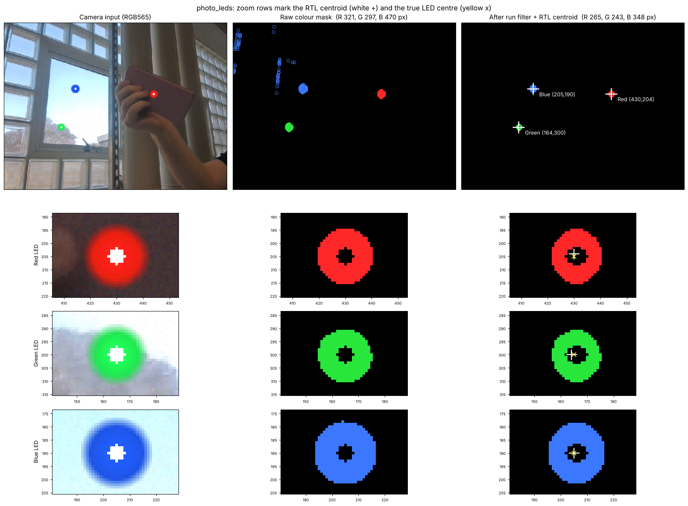
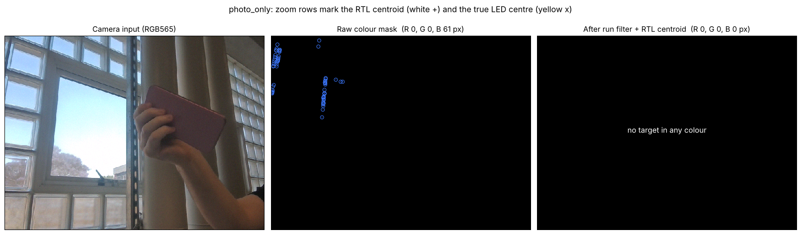

# V2 image processing (M2, Wilson): three-colour LED masking

Branch `feature/v2-image-processing`. Owner: Wilson (M2). Reviewer: Marcus (M3, consumes the mask).

## What changed

| File | Status | What it is |
|---|---|---|
| `rtl/image_processing/led_colour_mask.sv` | new | Combinational red / green / blue LED classifier for RGB565. Zero latency. |
| `rtl/image_processing/red_mask.sv` | **rewritten** | Thin wrapper over `led_colour_mask`. **Port list unchanged**, default output bit-identical to V1. |
| `rtl/image_processing/colour_run_filter.sv` | new | Horizontal run-length noise filter, zero latency, no line buffer. |
| `rtl/image_processing/tri_led_detect.sv` | new | Mask → filter → 3 × `led_centroid` (Marcus's V2 gated centroid). For the three-bay demo. |
| `sim/unit/red_mask_v1_ref.sv` | new | Frozen copy of the V1 `red_mask` (renamed `red_mask_v1_ref`), the golden reference. |
| `sim/unit/red_mask_v1_equiv_tb.sv` | new | Exhaustive V1-equivalence bench. |
| `sim/unit/led_colour_mask_tb.sv` | new | Exhaustive classifier bench. |
| `sim/unit/tri_led_detect_tb.sv` | new | Synthetic full-frame bench with speckle noise. |
| `sim/integration/tri_led_photo_tb.sv` | new | `tri_led_detect` on a real lab photo with LEDs superimposed. |
| `sim/integration/top_led_photo_tb.sv` | new | The real `major_project_top`, every device an Ed model, from the camera pins to the UGV02 UART. |
| `sim/run_image_processing_tests.sh` | new | Runs all of the above plus every existing bench that uses `red_mask`. |
| `sim/tools/make_led_frames.py`, `render_led_masks.py` | new | Test-frame generator and before/after picture renderer. |
| `sim/data/lab_photo.jpg`, `scenes.json` | new | Source photo and true LED centres. The `.hex` frames are generated on first run (~16 MB, not committed). |

No other file in the repository is modified. `major_project_top.sv` is untouched.

## How the mask works

Each pixel is classified by a *dominant-channel* test:

```
primary channel        >= <COL>_MIN
each other channel     <= its ceiling
primary channel        >= each other channel + <COL>_MARGIN
```

MIN and MARGIN compare in 5-bit space (green's LSB dropped). Ceilings on the green channel use the full 6-bit value, as V1 did. Because a pixel must beat **both** other channels by a positive margin, at most one colour can be true per pixel, and white, black, yellow, cyan and magenta are all rejected by construction.

A bright LED's core usually saturates to near-white and is rejected; the coloured halo around it is accepted, and the centroid of a ring is its centre. If the halo is too thin on hardware, lower the OV7670 exposure rather than loosening thresholds.

Defaults (tune on hardware from SignalTap captures of the real LEDs):

| Colour | MIN | Ceilings | MARGIN |
|---|---|---|---|
| Red (V1 values) | R ≥ 20 | G6 ≤ 24, B ≤ 12 | 8 |
| Green | G ≥ 18 | R ≤ 14, B ≤ 20 | 6 |
| Blue | B ≥ 18 | R ≤ 14, G6 ≤ 45 | 6 |

## Fitting into the static top level

`major_project_top` instantiates `red_mask` with no parameters and the V1 port list, and it has no clock on that instance. So:

- `red_mask` keeps **exactly** the V1 ports. An extra output port left unconnected by the top raises Verilator `PINMISSING`, which is fatal with the team's build flags; that was tried and rejected.
- With default parameters it is **bit-identical to V1** on all 65,536 RGB565 codes (`red_mask_v1_equiv_tb`). The top-level red tracking does not change at all.
- A new parameter `TARGET_COLOUR` (0 red, 1 green, 2 blue) selects which colour drives `is_red`. The top uses the default (red).
- The run filter needs a clock, which `red_mask` does not get in the static top, so the filter lives in `tri_led_detect` only. In the top, the red path relies on Marcus's V2 gates (on the lab photo the red mask has no false pixels anyway).

`tri_led_detect` is the drop-in for V3 bay sequencing. Wiring it into the top needs a wider `vision_result_cdc` (three results per frame) and a selected-bay input: a Jason/Marcus interface change, deliberately not made here.

## Why the filter is in front of the centroids

Marcus's V2 `led_centroid` rejects a frame whose target pixels do not fill their bounding box (fill confidence < 64/256). On the lab photo, a few dozen pixels along the bright window frames and metal post read as blue. Without the filter they stretch the blue box across half the picture, fill confidence drops to **2**, and the **real blue LED is rejected**. With the filter they are removed and the LED is accepted at confidence 184. `tri_led_photo_tb` checks both.



Control frame, same photo without LEDs (every detection would be false): the raw mask has 61 blue edge pixels (ringed), the filter removes all of them, and no colour reports a target.



All mask pixels in these pictures are dumped from the RTL simulation (`tri_led_photo_tb +DUMP_DIR=...`), not computed in Python. The LEDs are drawn onto a real photo (saturated core, coloured body, soft glow, sensor noise); a real capture with the real LEDs is the next check.

## Running

```bash
./sim/run_image_processing_tests.sh          # everything, about 3 minutes
./sim/run_image_processing_tests.sh quick    # skip the whole-robot camera-pin bench
```

Needs Verilator 5.050 (Ed's models use 5.050 lint codes) and, the first time, Python 3 with numpy and Pillow to build the frames; matplotlib for the pictures.

## Results

Verilator 5.050, branch `feature/v2-image-processing`, `./sim/run_image_processing_tests.sh`:

| Bench | Result |
|---|---|
| `red_mask_v1_equiv_tb` (new) | PASS, 1,179,648 checks: every RGB565 code, valid 0/1, identical to V1; target select routes green/blue |
| `led_colour_mask_tb` (new) | PASS, 458,801 checks: every code against an independent model, at most one colour per pixel, valid gating |
| `tri_led_detect_tb` (new) | PASS, 29 checks: 3 LEDs with white cores amid ~340 speckles, centroids exact, exact pixel counts, filter-off copy rejects all three on fill |
| `tri_led_photo_tb` (new) | PASS, 14 checks: lab photo, no false target without LEDs; with LEDs R (430,204), G (164,300), B (205,190) vs true (430,205), (165,300), (205,190); filter-off blue rejected (confidence 2) |
| `top_led_photo_tb` (new) | PASS, 61 checks, 33 camera frames, 66 UART commands: see below |
| `red_mask_tb` (existing, unchanged) | PASS, 14 checks |
| `camera_stream_adapter_tb` (existing) | PASS |
| `camera_capture_vision_tb` (existing) | PASS |
| `major_project_top_tb` (existing) | PASS, 15 checks |
| `top_uart_safety_tb` (existing) | PASS, 8 checks |
| `top_uart_latency_tb` (existing) | PASS |
| `red_vision_pipeline_tb` (existing) | KNOWN-FAIL: fails identically on `main` before this branch (see below) |

**Whole robot, from the camera pins** (`top_led_photo_tb`): the unmodified `major_project_top` with Ed's OV7670 model configured over SCCB by the real `ov7670_config`, the HC-SR04 model, the IR remote model and the UGV02 model decoding the real UART. Nothing forced.

| Scene | Red target | LEDR2/3/4 | FSM | Gated PWM L/R | UGV02 decoded L/R |
|---|---|---|---|---|---|
| Red LED right of centre on the pink phone, green + blue distractors | (430, 205) | 1/0/1 | APPROACH | 77 / 23 (turn right) | 77 / 23 |
| Red LED left of centre | (149, 330) | 1/1/0 | APPROACH | 8 / 92 (turn left) | 8 / 92 |
| Green + blue LEDs only | none | 0/0/0 | ACQUIRE | 0 / 0 | 0 / 0 |
| Photo, no LEDs | none | 0/0/0 | ACQUIRE | 0 / 0 | 0 / 0 |
| Red LED back | (430, 205) | 1/0/1 | APPROACH | 77 / 23 | 77 / 23 |
| Red LED, obstacle at 200 mm | (430, 205) | 1/0/1 | DOCKED | 0 / 0 | 0 / 0 |

True red centres are (430, 205) and (150, 330). Expected PWM comes from an independent model of Jason's V2 speed-scheduled steering. No vision CDC overrun, SCCB, sonar or UART protocol errors.

## Known issues found (not in M2 files)

1. **`red_vision_pipeline_tb` fails on `main`** (commit 058bd48, before this branch) with the same message: it was written for the V1 centroid and its 3-pixel scattered target is now rejected by Marcus's V2 shape/fill gates (PR #4). M3 to update. The regression script reports it as KNOWN-FAIL so it stays visible.
2. **Arming order (docking_fsm, M4).** The IR latch is set from reset, and `docking_fsm` holds `STOPPED` while it is set and leaves `STOPPED` only through SW0 OFF → `IDLE`. If SW0 is already ON when CH+ releases the latch, the robot stays in `STOPPED` and never drives: the operator must switch SW0 off and on again. This is the README's "motion intermittent, improved after SW0 OFF→ON". It may be the intended safe behaviour, but it should be written into the operating procedure (or the FSM changed). `top_led_photo_tb` models the working order: SW0 OFF, press CH+, then SW0 ON.
3. **Verilator version.** The team uses 5.050. Ed's simulation models use lint codes (`PROCASSINIT`) that older Verilator (5.020) rejects, and 5.020 also miscompiles some `fork` code. Use 5.050.
